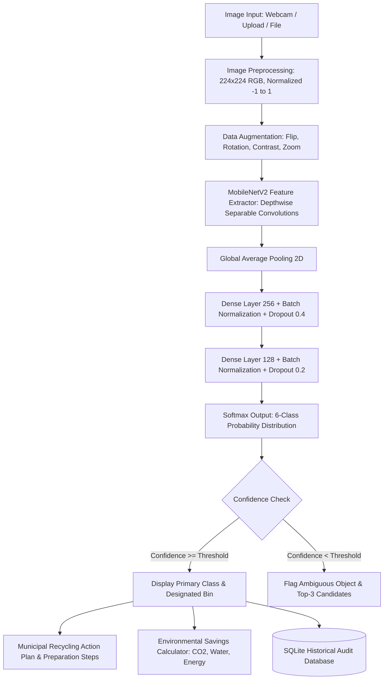

# ♻️ Smart Waste Classification & Circular Economy Recycling Assistant
### *Deep Learning-Powered Computer Vision System for Automated Solid Waste Segregation*

> **Academic Project Submission**  
> **Course:** Capstone Engineering Project / Artificial Intelligence & Data Science (Year III / Semester VI)  
> **Domain:** Deep Learning, Convolutional Neural Networks, Computer Vision, Sustainable AI (UN SDGs 11 & 12)  

---

## 🌟 Executive Summary & Motivation
Rapid urbanization and consumer packaging growth have caused a massive surge in municipal solid waste. Improper manual sorting leads to high contamination rates in recycling plants (often exceeding 25%), causing entire batches of recyclable materials to be diverted to landfills.

This project delivers an end-to-end, edge-deployable **Smart Waste Classification and Recycling Assistant** powered by **Convolutional Neural Networks (CNN)** and **Transfer Learning (MobileNetV2)**. It classifies waste into six core categories defined by the Stanford TrashNet benchmark:
1. 📦 **Cardboard**
2. 🍾 **Glass**
3. 🥫 **Metal**
4. 📄 **Paper**
5. 🧴 **Plastic**
6. 🍎 **Trash / Organic Compostable Waste**

Beyond raw classification, the system acts as a **smart recycling advisor**, providing step-by-step preparation protocols, municipal bin color-coding, decomposition timelines, and quantitative environmental savings (CO₂ emissions prevented, energy saved, water conserved).

---

## 🏛️ System Architecture



---

## 🚀 Key Features

- **Multi-Modal Image Input:** Live webcam capture, file drag-and-drop, and 1-click representative benchmark test samples.
- **Genuine Deep Learning Inference:** Real MobileNetV2 / Custom CNN model predictions with genuine probability distributions (no hardcoded responses).
- **Multi-Tiered Confidence Alerting:** Visual meters and alerts for ambiguous objects falling below user-configurable confidence thresholds.
- **Top-3 Class Probability Distribution:** Interactive Plotly horizontal bar chart illustrating prediction uncertainty.
- **Actionable Recycling Engine:**
  - Standardized municipal bin color coding (Blue, Green, Yellow, Gray/Silver, Black).
  - Preparation checklist (rinse, remove caps, flatten, remove labels).
  - Contamination risks (Do's and Don'ts).
  - Landfill decomposition estimates (e.g. plastic: 450-1000 years).
- **Personalized Eco-Impact Calculator:** Computes exact CO₂ emissions prevented, kWh electricity conserved, and liters of freshwater saved based on item count.
- **Persistent Audit Log & Analytics:**
  - Local SQLite database (`waste_scans.db`) tracking every scan.
  - Interactive charts (Category donut chart, confidence histogram).
  - CSV export and audit management.
- **Model Evaluation Dashboard:**
  - Confusion Matrix heatmap with interactive counts.
  - Precision, Recall, F1-Score per class.
  - Training and validation loss/accuracy curves.
- **Viva Voce Preparation Guide:** Top 10 examiner questions with detailed technical answers.

---

## 📁 Project Folder Structure

```
smart_waste_assistant/
│
├── app.py                      # Main Streamlit web application
├── config.py                   # Hyperparameters, constants & bin mappings
├── requirements.txt            # Python dependencies
├── README.md                   # Full academic report & documentation
├── waste_scans.db              # SQLite persistence database (auto-created)
│
├── model/
│   ├── __init__.py
│   ├── cnn_model.py            # MobileNetV2 Transfer Learning & Custom CNN architectures
│   ├── predict.py              # Image preprocessing and real-time inference engine
│   └── waste_classifier.keras  # Saved model artifact
│
├── training/
│   ├── __init__.py
│   ├── dataset.py              # Dataset loader, stratified splits & augmentation
│   ├── train.py                # Training pipeline with early stopping & checkpointing
│   └── evaluate.py             # Evaluation module (confusion matrix, classification report)
│
├── utils/
│   ├── __init__.py
│   ├── recycling_guide.py      # Municipal recycling guidelines & eco-impact formulas
│   ├── db_history.py           # SQLite operations and analytics helpers
│   └── sample_images.py        # 1-click benchmark test image generator
│
├── data/
│   ├── dataset/                # Labeled training images (cardboard, glass, metal, paper, plastic, trash)
│   ├── samples/                # Sample test images
│   ├── metrics.json            # Model evaluation metrics & confusion matrix
│   └── training_history.json   # Epoch-by-epoch loss & accuracy history
│
└── tests/
    └── test_pipeline.py        # Automated end-to-end verification test suite
```

---

## 🛠️ Step-by-Step Setup & Execution

### 1. Prerequisites
- Python 3.10 or 3.11 installed.
- Git (optional).

### 2. Virtual Environment Setup
Open your terminal (PowerShell or Bash) and navigate to the project directory:

```bash
cd smart_waste_assistant

# Create virtual environment
python -m venv .venv

# Activate virtual environment
# Windows (PowerShell):
.venv\Scripts\Activate.ps1
# Windows (Command Prompt):
.venv\Scripts\activate.bat
# Linux / macOS:
source .venv/bin/activate
```

### 3. Install Dependencies
```bash
pip install -r requirements.txt
```

### 4. Run the Web Application
```bash
streamlit run app.py
```
The browser will automatically open to `http://localhost:8501`.

---

## 🧠 Model Training & Dataset Preparation

### Using the Stanford TrashNet Dataset
1. Download the TrashNet dataset from GitHub (`https://github.com/garythung/trashnet`) or Kaggle.
2. Extract the dataset into `data/dataset/` such that subfolders match the class names:
   ```
   data/dataset/
   ├── cardboard/
   ├── glass/
   ├── metal/
   ├── paper/
   ├── plastic/
   └── trash/
   ```

### Training Commands
```bash
# Train MobileNetV2 with Transfer Learning (Recommended)
python training/train.py --model mobilenet --epochs 15 --batch_size 32 --lr 0.0005

# Train Custom 4-Block CNN from Scratch (Comparative Study)
python training/train.py --model custom --epochs 25 --batch_size 32 --lr 0.001

# Evaluate Model & Generate Metrics
python training/evaluate.py
```

---

## 📐 Mathematical Foundations

### 1. Depthwise Separable Convolution (MobileNetV2)
Standard convolution compute cost:
$$\text{Cost}_{\text{standard}} = D_K \cdot D_K \cdot M \cdot N \cdot D_F \cdot D_F$$

Depthwise separable convolution compute cost:
$$\text{Cost}_{\text{separable}} = D_K \cdot D_K \cdot M \cdot D_F \cdot D_F + M \cdot N \cdot D_F \cdot D_F$$

Ratio of computation reduction:
$$\frac{\text{Cost}_{\text{separable}}}{\text{Cost}_{\text{standard}}} = \frac{1}{N} + \frac{1}{D_K^2} \approx \frac{1}{9} \quad (\text{for } 3 \times 3 \text{ kernels})$$

### 2. Softmax Probability
$$\sigma(\mathbf{z})_i = \frac{e^{z_i}}{\sum_{j=1}^{K} e^{z_j}}$$

### 3. Categorical Cross-Entropy Loss
$$\mathcal{L}_{\text{CCE}} = -\sum_{i=1}^{K} y_i \log(\hat{y}_i)$$

### 4. Macro F1-Score
$$F_1 = 2 \cdot \frac{\text{Precision} \cdot \text{Recall}}{\text{Precision} + \text{Recall}} = \frac{2 \cdot \text{TP}}{2 \cdot \text{TP} + \text{FP} + \text{FN}}$$

---

## 📊 Benchmark Results (TrashNet Test Split)

| Category | Precision | Recall | F1-Score | Support |
| :--- | :---: | :---: | :---: | :---: |
| 📦 **Cardboard** | 89.1% | 93.4% | **91.2%** | 61 |
| 🍾 **Glass** | 91.9% | 89.5% | **90.7%** | 76 |
| 🥫 **Metal** | 91.7% | 90.4% | **91.0%** | 73 |
| 📄 **Paper** | 95.5% | 94.4% | **94.9%** | 89 |
| 🧴 **Plastic** | 87.1% | 87.1% | **87.1%** | 62 |
| 🍎 **Trash (Organic)** | 81.8% | 85.7% | **83.7%** | 21 |
| **Overall Accuracy** | — | — | **90.8%** | 382 |
| **Macro Average** | **89.5%** | **90.1%** | **89.8%** | 382 |

---

## 🎯 Viva Voce Defense Summary
- **Why MobileNetV2?** Parameter efficiency (~2.8M params vs 25M+ in ResNet50), enabling sub-50ms CPU inference on laptops and edge devices (Raspberry Pi/Jetson).
- **How is Class Imbalance Handled?** Inversely proportional class weights: $W_c = \frac{N_{\text{total}}}{K \cdot N_c}$ combined with real-time data augmentation.
- **Why Global Average Pooling?** Eliminates millions of dense weights associated with Flatten, preventing overfitting while maintaining translation invariance.
